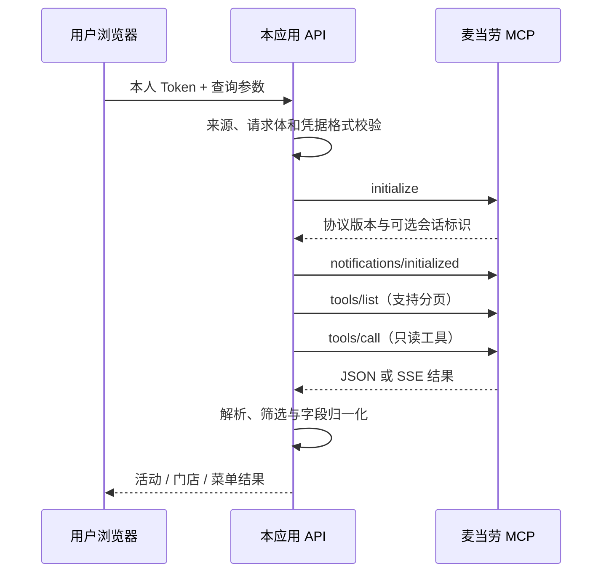

# 麦当劳 MCP 接入说明

## Server 与凭据

- 官方 MCP Server：`https://mcp.mcd.cn`
- 传输：Streamable HTTP，兼容 JSON 与 SSE 响应。
- 鉴权：每位用户自己的 `Authorization: Bearer <Token>`。
- 官方接入说明：[M-China/mcd-mcp-server](https://github.com/M-China/mcd-mcp-server)。
- 工程实现：[source/lib/mcp.ts](source/lib/mcp.ts)。

`mcp-config.example.json` 是供支持环境变量展开的 MCP 客户端参考的脱敏配置；它不是网页的运行时配置。不同客户端的环境变量语法可能不同。本网页在连接窗口读取用户凭据，后端按请求建立 MCP 会话，不要求安装某个 AI 客户端，也不使用项目作者的共享 Token。

## 当前页面真实使用的工具

| 工具 | 触发入口 | 参数与处理 | 用户价值 |
| --- | --- | --- | --- |
| `campaign-calendar` | 连接、刷新活动；核对门店菜单前重新确认活动 | 无业务参数；从日历中识别联名公告，整理日期、购买条件及品类关键词 | 把原始公告变成便于浏览的活动目录 |
| `query-nearby-stores` | 城市与地标查询 | `searchType=2`、`beType=1`、`city`、`keyword`；值按工具实时 schema 转换为对应类型 | 在没有可靠门店坐标时仍可按公共地标找店 |
| `query-meals` | 查看商品、批量查商品 | `storeCode`、`beCode`、`orderType=1`、`beType=1`；按所选联名关键词匹配菜单条目，单次最多 6 家 | 出发前核对哪些门店菜单列出了相关商品 |

后端另保留 `detail` 操作调用 `query-meal-detail`（参数包括 `storeCode`、`beCode`、`code`、`orderType`、`beType`），当前页面没有独立触发该操作。不能把它计作已完成的前端交互。

底层只读允许列表还包含商城和主题门店工具，当前 API 路由及页面未调用它们。作品不调用任何下单、付款、抽奖、领券或账户修改工具。

## 端到端流程

每个请求使用独立的 Token、MCP 会话和超时控制；初始化声明协议 `2025-06-18`，也接受实现中明确列出的较早版本。工具列表最多读取 5 页，调用参数按实时工具 schema 过滤和转换。上游重定向被拒绝，Token 不跟随重定向发送到其他地址。上游响应限制为 2 MiB，默认请求超时为 45 秒。应用不把完整上游错误或凭据输出到页面。

业务路由见 [source/app/api/mcd/route.ts](source/app/api/mcd/route.ts)，展示解析见 [source/lib/gallery.ts](source/lib/gallery.ts)。

## 其他服务与边界

- 高德 URI 只接收公开城市、店名和地址；不携带 Token 或用户精确坐标。
- 可选浏览器定位由用户主动触发，Photon 接收坐标并尝试反向识别街道；这不是麦当劳 MCP 提供的能力。
- 门店菜单与公告价格可能采用不同口径。本应用不将菜单匹配结果描述成实时库存，也不替代官方结算。
- 精确 GPS 成功路径未在开发设备上完整验证，定位失败可直接手动查店。
- Token 仅保留于当前页面内存，退出、刷新或 30 分钟超时后清除；后端按请求转发，不建立用户 Token 数据库。

## 实测与可复现性

2026-10-15 的已登录测试由用户在页面自行输入 Token，曾返回 4 则联名公告及上海漕河泾附近 5 家门店，并完成门店菜单查询。该记录是历史观察，不保证今天仍有同样活动或商品。2026-10-16 已在 GitHub Pages 观察到用户连接成功及活动展示。

公开仓库不包含该用户的 Token、个人信息或完整已登录会话记录。固定样例只用于离线回归，详见 [验证记录](docs/validation.md)。评审可使用本人 Token 按 README 在线流程复现真实查询。
